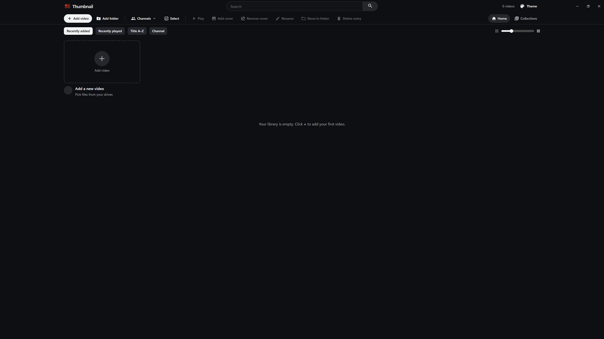

<p align="center">
  
</p>

<h1 align="center">Thumbnail</h1>

<p align="center">
  <b>Your own video library, as a clean thumbnail grid.</b><br>
  A light, portable Windows app that turns the videos on your drives into a home page you can browse.<br>
  Add a folder or a single video, and it shows up as a card. Click a card and it opens in your default player.
</p>

<p align="center">
  
  
  
  
</p>

---

## Features

- Thumbnail grid with an adjustable size and smooth animations
- Channels, collections and multi-select to organize videos
- Several color themes, including a retro one
- Search across the whole library
- Its own window with a custom title bar, like Discord or Spotify
- Videos play in your default player; nothing is uploaded anywhere
- Portable: a single 1.6 MB exe, no installer, no account, no internet needed

## Screenshot

<p align="center">
  
</p>

## How it works

`Thumbnail.exe` is written in **Rust**. It opens a frameless native window ([tao](https://github.com/tauri-apps/tao)) and draws the interface with the Microsoft Edge WebView2 that ships with Windows ([wry](https://github.com/tauri-apps/wry)). A small local server inside the exe ([tiny_http](https://github.com/tiny-http/tiny-http)) serves the page and the library API on `127.0.0.1`. The page itself (HTML, CSS, JS and fonts) is built into the exe, so there is nothing else to ship.

Your library lives in a `data\` folder next to the exe. Videos on another drive are stored with absolute paths and found again when a drive letter changes.

```
src\              the app: window, local server, library, file dialogs
  main.rs         window, title bar and startup (one copy at a time)
  server.rs       local API and media streaming
  library.rs      library, channels, collections, settings (JSON in data\)
  paths.rs        portable paths between drives
  dialogs.rs      native Add / Locate dialogs
  platform.rs     open in player, show in folder, play all
  web.rs          embeds app\web into the exe
app\web\          the interface (HTML, CSS, JS, fonts)
brand\            logo and app icon
data\             your library, covers, collections, settings (created on first run, not in this repo)
```

## Build it

You need Windows 10/11, [Rust](https://rustup.rs) with the MSVC toolchain, and the *Visual Studio Build Tools* (C++ workload).

```bash
cargo build --release
```

The exe is `target\release\Thumbnail.exe`. Put it in any folder, next to `THIRD-PARTY-NOTICES.txt`; the `data\` folder is created on first run. During development, `cargo run` starts it straight away.

## Third-party software

The WebView2 loader, the Rust libraries and the fonts have their own licenses. See [THIRD-PARTY-NOTICES.txt](THIRD-PARTY-NOTICES.txt).

## License

Copyright © 2026. All rights reserved. The source is published for viewing and as a portfolio piece; it may not be copied, modified, redistributed or sold without permission.
